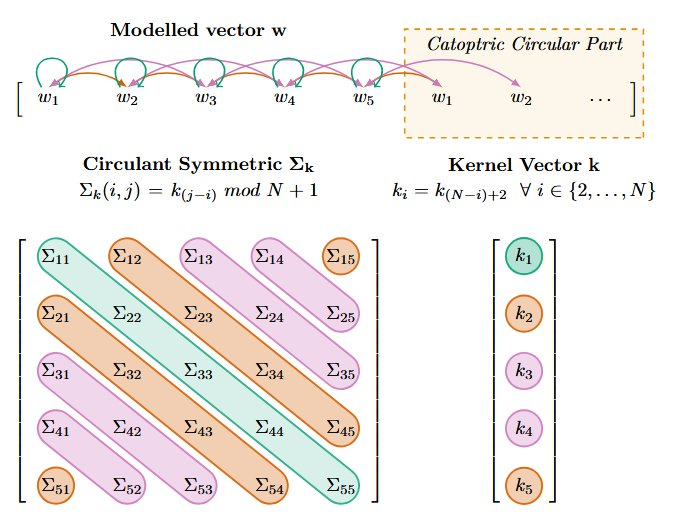

# Structure Matters More than Flexibility

> *Modeling Covariances for Efficient Approximate Inference in Bayesian Neural Networks*

---

## Overview

This repository provides the official implementation of the **Circulant-Constrained Gaussian** — a novel posterior family for Bayesian Deep Learning that leverages the spectral properties of circulant matrices to model rich weight correlations with minimal parameter overhead.

We challenge the common assumption that posterior *flexibility* (more learnable parameters) drives performance. Instead, we show that **covariance structure** is the key ingredient. Our method matches or surpasses other structured variational approximations in calibration and out-of-distribution detection, while requiring up to **20,000× fewer parameters**.

---

## The Circulant Covariance

A circulant symmetric matrix $\Sigma_k$ is fully defined by a single generating kernel vector $\mathbf{k}$:

$$\Sigma_k(i,j) = k_{(j-i) \bmod N + 1}$$

with the symmetry constraint:

$$k_i = k_{(N-i)+2} \quad \forall\, i \in \{2, \ldots, N\}$$

This means the entire $N \times N$ covariance matrix is parameterised by just $\lceil N/2 \rceil + 1$ values. Matrix-vector products are computed via the **Fast Fourier Transform**, making inference fast and memory-efficient.



*The weight vector **w** is modelled using a circulant structure. The catoptric (mirror) extension on the right enforces symmetry. Each diagonal of the covariance matrix shares a single kernel value $k_i$.*

---

## Repository Structure

```
.
├── train_resnet.py          # Main training & evaluation script
├── corrupt_utils.py         # Dataset loaders, metrics, calibration utilities
├── layers/                  # Custom Bayesian layer implementations
│   ├── LinearCirculant.py
│   ├── Conv2dCirculant.py
│   ├── LinearDiagonal.py
│   ├── Conv2dDiagonal.py
│   ├── LinearELRG.py
│   ├── Conv2dELRG.py
│   ├── LinearRank1.py
│   ├── Conv2dRank1.py
│   ├── LinearKTied.py
│   ├── Conv2dKtied.py
│   └── ...
├── requirements.txt
└── README.md
```

---

## Environment Setup

### Option A — pip

> **PyTorch must be installed first** with the correct CUDA index URL, before the rest of the dependencies.

```bash
# 1. Install PyTorch (CUDA 12.1 wheels)
pip install torch==2.2.2 torchvision==0.17.2 torchaudio==2.2.2 \
    --index-url https://download.pytorch.org/whl/cu121

# 2. Install remaining dependencies
pip install -r requirements.txt
```

### Option B — conda

```bash
conda create -n circulant-bnn python=3.10 -y
conda activate circulant-bnn

pip install torch==2.2.2 torchvision==0.17.2 torchaudio==2.2.2 \
    --index-url https://download.pytorch.org/whl/cu121

pip install -r requirements.txt
```

---

## Data Preparation

All loaders read from a single `data_dir` root. Set it once in `Config` and everything resolves automatically.

```
data_dir/
├── Imagenet/
│   ├── train/
│   └── val/
├── Places365/
│   └── val/
└── Imagenet-C/
    └── <corruption>/
        └── <severity>/
```


---

## Running an Experiment


All hyperparameters are controlled by the `Config` dataclass at the top of `train_resnet.py`. Edit the entry point block or instantiate `Config` programmatically.

### Deterministic baseline (ResNet-20, ImageNet)
**The following replicates Table 3: Numerical classification results on ImageNet**
Experiments report the mean of three seeds 10,50 20 
```python
# train_resnet.py — entry point
cfg = Config(
    cov_type     = "Circulant",
    resnet_depth = 20,
    init_scheme   = "Xavier"
    num_classes  = 1000,
    dataset      = "Imagenet",
    data_dir     = "./data",   # expects ./data/Imagenet/train and ./data/Imagenet/val
    batch_size   = 16,
    num_epochs   = 150,
    lr           = 1e-3,
    kl_weight    = 0.0001,
    seed         = 50, 
    device       = "cuda:0",
)
```

```bash
python train_resnet.py
```

### Supported `cov_type` values

| Value | Description |
|---|---|
| `Deterministic` | Standard MAP / point-estimate ResNet |
| `Dropout` | MC Dropout (Gal & Ghahramani, 2016) |
| `Diagonal` | Mean-field diagonal Gaussian |
| `Circulant` | **Ours** — Circulant-Constrained Gaussian |
| `CirculantFFT` | Circulant via FFT (faster for large kernels) |
| `Ktied` | K-tied covariance |
| `ELRG` | Extended Low-Rank Gaussian |

---

## Key Hyperparameters

| Parameter | Description | Default |
|---|---|---|
| `circ_size` | Circulant kernel size (controls expressiveness vs. parameter count) | `20` |
| `kl_weight` | Weight of the KL divergence term in the ELBO | `1e-4` |
| `kl_anneal` | KL annealing strategy (`Scaled` or `Linear`) | `Scaled` |
| `mc_samples_test` | MC samples at test time (set to `1` for Deterministic) | `10` |
| `init_scheme` | Weight initialisation scheme (`Xavier`, `Scaled`, `2xScaled`) | `Xavier` |

---

